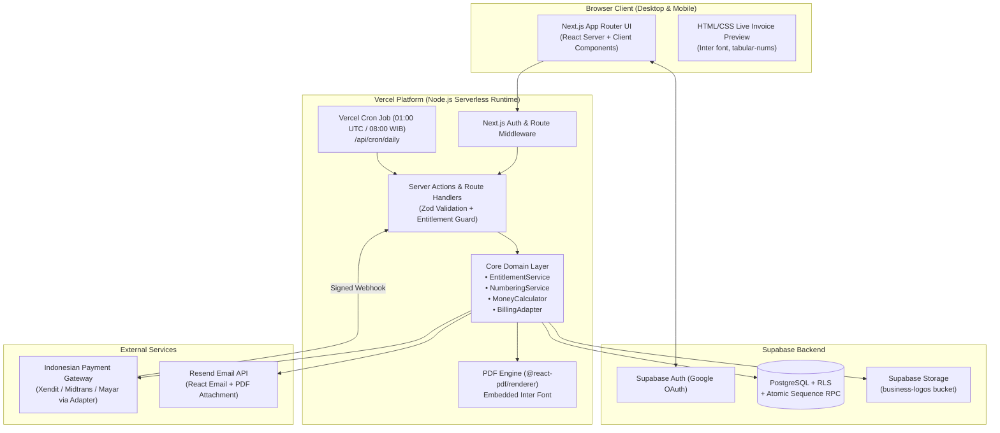

# ARCHITECTURE — System Design, Module Boundaries & Technical Stack

| Field | Value |
| :--- | :--- |
| Product name | **Tagiva** (`tagiva.com`, see `PRD.md` `D-59`) |
| Document status | **Approved** |
| Version | 1.1.0 |
| Last updated | 2026-10-27 |
| Depends on | `PRD.md` (v1.0.0), `DESIGN_SYSTEM.md` (v1.1.0), `UX_FLOWS.md` (v1.1.0) |

---

## 0. Purpose of this document

This document defines **how the system is structured**, **which technologies are used at each layer**, **where business rules live**, and **how external services (Supabase, PDF engine, Email, Payment Gateway, Cron) interact**.

Its goals are:
1. Keep business logic (entitlements, numbering, money math, status rules) in pure, server-side domain modules (`NFR-6`) rather than scattered across UI components.
2. Isolate external dependencies—especially the undecided Indonesian payment gateway (`D-10`, `D-48`) and future invoice templates (`D-03`)—behind clean TypeScript interfaces.
3. Set explicit performance and reliability targets (`NFR-7`).

How to read requirement keywords:
- **MUST**: required for MVP launch.
- **SHOULD**: expected for MVP. Can only be dropped with an explicit decision.
- **MAY**: optional optimization.

---

## 1. Reused decisions from prior documents

| Decision ID | Summary | Architectural Impact |
| :--- | :--- | :--- |
| **D-02, D-37** | **Next.js** (App Router), **Supabase** (Postgres, Auth, Storage), **Vercel**, **Tailwind CSS + shadcn/ui + Lucide**. | Fullstack Next.js monolith deployed on Vercel Serverless Functions, backed by Supabase. |
| **D-03, D-36, D-41** | 1 MVP invoice template (`Inter` font only), extensible to more templates later. | Template registry pattern (`TemplateId = 'modern-minimalist'`) with paired Web Preview and `@react-pdf/renderer` implementations. |
| **D-10, D-16, D-22, D-48** | Local Indonesian gateway (Xendit / Midtrans / Mayar), 4 durations (`1m/3m/6m/12m`), manual & auto-renew modes. | `PaymentGatewayAdapter` interface decouples subscription domain logic from gateway-specific SDKs and webhooks. |
| **D-11, D-12, D-21, D-23, D-28, D-29, D-33** | Role & plan matrix (`Visitor`, `Free`, `Pro`, `Lapsed`), 3-slot cap, delete rules, Lapsed read-only rules. | Centralized server-side `EntitlementService` called by every mutation and combined with Postgres RLS. |
| **D-13, D-18, D-30, D-39, D-42** | `INV-[PREFIX]-[YYYY]-[MM]-[XXXX]`, annual reset in WIB, assigned only when leaving `Draft`. | Atomic database RPC function assigns sequence numbers inside a transaction to prevent race conditions (`FR-2.7`). |
| **D-14, D-24, D-31** | Google OAuth only; no preview or invoice creation before sign-in. | Next.js Middleware protects all `/onboarding`, `/dashboard`, `/invoices/*`, `/clients`, and `/settings/*` routes. |
| **D-26, D-50** | Expiry reminders at **30d, 14d, 3d, 0d**; scheduled via **Vercel Cron** at `08:00 WIB`. | `/api/cron/daily` route handler authenticated via `CRON_SECRET`. |
| **D-49** | Server-side PDF rendering via **`@react-pdf/renderer`**. | Runs in standard Node.js Vercel Serverless runtime (`runtime = 'nodejs'`) with bundled `Inter` `.ttf` font files. |

---

## 2. High-Level System Architecture



---

## 3. Repository & Directory Structure (`app/` + `features/` Split)

Tagiva uses a strict **`src/app/` + `src/features/`** module architecture (modeled after `rabbit-customer-web`):
- **`src/app/` is for routing only:** Every route `page.tsx` is a thin re-export of its corresponding feature module (`export { <Feature>Page as default, <feature>Metadata as metadata } from '@/features/<feature>'`). No feature UI, business logic, or hooks live inside `src/app/`.
- **`src/features/<feature>/` owns everything for that feature:** `page.tsx`, `metadata.ts`, `actions.ts`, `queries/`, `hooks/`, `components/`, `config/`, `types/`, and `index.ts`.
- **`src/components/` holds only cross-feature shared UI:** `ui/` (shadcn primitives), `layout/` (app shell, headers, banners), and `invoice-templates/` (shared A4 Web Preview & PDF renderer used across Builder, Public Link, PDF API, and Landing page).

```text
/
├── docs/                           # Project documentation (PRD, DESIGN_SYSTEM, etc.)
│   └── assets/
│       └── tagiva-logo.png         # Canonical Tagiva logo copy (D-60)
├── public/
│   ├── logo.png                    # Official Tagiva brand logo (1024x1024 RGBA PNG, D-60)
│   └── fonts/
│       └── inter/                  # Static Inter .ttf files (Regular, Medium, SemiBold, Bold) for @react-pdf/renderer
├── supabase/
│   └── migrations/                 # Versioned SQL migrations, RLS policies, and RPC functions
├── src/
│   ├── app/                        # ROUTING LAYER ONLY (thin re-exports from src/features/*)
│   │   ├── (marketing)/            # Public pages: /, /pricing, /terms, /privacy
│   │   ├── (auth)/                 # /login (re-exports features/auth), /auth/callback (OAuth route)
│   │   ├── (app)/                  # Protected routes (requires Google session)
│   │   │   ├── onboarding/         # /onboarding -> re-exports features/onboarding
│   │   │   ├── dashboard/          # /dashboard -> re-exports features/dashboard
│   │   │   ├── invoices/
│   │   │   │   ├── new/            # /invoices/new -> re-exports features/invoices/new
│   │   │   │   └── [id]/           # /invoices/[id] -> re-exports features/invoices/detail
│   │   │   ├── clients/            # /clients -> re-exports features/clients
│   │   │   └── settings/           # /settings & /settings/billing -> re-exports features/settings
│   │   ├── (public-invoice)/
│   │   │   └── i/[token]/          # /i/[token] -> re-exports features/public-invoice
│   │   └── api/
│   │       ├── invoices/[id]/pdf/  # GET: authenticated PDF download
│   │       ├── public/i/[token]/pdf/ # GET: public client PDF download
│   │       ├── webhooks/billing/   # POST: payment gateway webhook receiver
│   │       └── cron/daily/         # GET: Vercel Cron (reminders & subscription expiry)
│   ├── features/                   # FEATURE MODULES (page, metadata, actions, queries, hooks, components, types)
│   │   ├── auth/                   # Login page, Google OAuth actions, useGoogleSignIn hook, GoogleSignInButton
│   │   ├── onboarding/             # 1-Step Business Setup page, form component, hooks
│   │   ├── dashboard/              # Invoices dashboard page, queries, filter hooks, summary cards, list table
│   │   ├── invoices/               # Shared invoice builder components, hooks, queries, & Server Actions
│   │   │   ├── new/                # /invoices/new page & metadata
│   │   │   └── detail/             # /invoices/[id] page & metadata
│   │   ├── public-invoice/         # /i/[token] public read-only client view, queries, components
│   │   ├── clients/                # /clients directory page, actions, queries, hooks, components
│   │   ├── settings/               # /settings business profile & logo actions, queries, hooks, components
│   │   │   └── billing/            # /settings/billing page, checkout actions, UpgradeProModal
│   │   ├── landing/                # / marketing landing page & hero preview components
│   │   ├── pricing/                # /pricing page, plan comparison cards & FAQ
│   │   └── legal/                  # /terms & /privacy pages and content config
│   ├── components/                 # SHARED UI ONLY (used across multiple features)
│   │   ├── ui/                     # shadcn/ui primitives (D-37)
│   │   ├── layout/                 # TagivaLogo, AppHeader, AppSidebar, FreeSlotCounter, SubscriptionBanners
│   │   └── invoice-templates/      # Modular templates shared by builder, public view, PDF API, & landing (D-03)
│   │       └── modern-minimalist/
│   │           ├── web-preview.tsx # On-screen HTML/Tailwind A4 component
│   │           └── pdf-document.tsx# Matching @react-pdf/renderer A4 component
│   ├── lib/
│   │   ├── domain/                 # Pure business rules (framework-agnostic, 100% unit-tested)
│   │   │   ├── entitlements.ts     # Plan & role permission checks (Free, Pro, Lapsed)
│   │   │   ├── calculations.ts     # Exact integer/decimal invoice math (NFR-4)
│   │   │   ├── numbering.ts        # Prefix validation & INV-PREFIX-YYYY-MM-XXXX formatting
│   │   │   ├── timezone.ts         # Asia/Jakarta (WIB) date helpers (NFR-5)
│   │   │   └── status.ts           # Status transitions & WIB overdue evaluation
│   │   ├── billing/
│   │   │   ├── adapter.ts          # PaymentGatewayAdapter interface (D-48)
│   │   │   ├── xendit-adapter.ts   # Xendit implementation
│   │   │   └── midtrans-adapter.ts # Midtrans implementation
│   │   ├── email/
│   │   │   ├── client.ts           # Resend SDK wrapper
│   │   │   └── templates/          # React Email templates (InvoiceEmail, ExpiryReminderEmail)
│   │   ├── i18n/
│   │   │   ├── ui-dictionary.ts    # App UI translations (EN / ID, D-47)
│   │   │   └── invoice-dictionary.ts # Invoice document translations (EN / ID, D-17)
│   │   ├── security/               # Redirect sanitizer, route matchers, & magic-byte file validator
│   │   ├── validations/            # Shared Zod schemas (profile, invoice, billing)
│   │   └── supabase/
│   │       ├── client.ts           # Browser Supabase client
│   │       ├── server.ts           # Server Component / Server Action Supabase client
│   │       └── admin.ts            # Service-role client (ONLY for webhooks, cron, and public token lookup)
│   └── types/
│       └── database.ts             # Supabase TypeScript definitions
└── vercel.json                     # Vercel Cron schedule configuration
```

---

## 4. Core Architectural Modules

### 4.1 Authentication & Session Middleware (`D-14`, `D-24`, `D-31`)
- Uses `@supabase/ssr` with HTTP-only cookies.
- **Next.js `middleware.ts`:**
  1. Refreshes the user's Supabase auth token on every request.
  2. Redirects unauthenticated visitors trying to access any `(app)` route (`/onboarding`, `/dashboard`, `/invoices/*`, `/clients`, `/settings/*`) to `/login?next=[path]`.
  3. Allows unauthenticated access **only** to `(marketing)`, `/login`, `/auth/callback`, `/i/[token]`, `/api/public/i/[token]/pdf`, `/api/webhooks/billing`, and `/api/cron/daily`.

### 4.2 Entitlement & Policy Engine (`src/lib/domain/entitlements.ts` — `NFR-6`)
Every Server Action and API Route **MUST** evaluate the user's effective role and entitlements on the server before mutating data.

- **Effective Plan State Resolution:**
  - `pro`: user has a subscription row where `status = 'active'` and `current_period_end > now()`.
  - `lapsed`: user has at least one historical subscription row where `current_period_end <= now()` and no currently active period (`D-23`).
  - `free`: user has never had an active subscription.
- **Pure Policy Functions (`canPerformAction`):**
  - `canCreateInvoice(planState, currentInvoiceCount)`:
    - `pro` → `true`
    - `free` or `lapsed` → `currentInvoiceCount < 3` (`D-12`, `D-33`)
  - `canEditInvoice(planState)`:
    - `pro` or `free` → `true`
    - `lapsed` → `false` (`D-23`, `D-28`)
  - `canDeleteInvoice(planState, invoiceStatus)`:
    - `pro` → `true` (`A-12`)
    - `free` → `invoiceStatus === 'draft'` (`D-29`)
    - `lapsed` → `false` (`D-28`)
  - `canChangeStatus(planState, fromStatus, toStatus)`:
    - Once `fromStatus !== 'draft'`, `toStatus` can never be `'draft'` (`A-16`).
    - `lapsed` → only allowed when `(fromStatus === 'sent' || fromStatus === 'overdue') && toStatus === 'paid'` (`D-28`, `A-18`).
    - `free` or `pro` → allowed for valid transitions (`draft -> sent`, `sent <-> paid`, `overdue -> paid`).
  - `shouldIncludePlatformFooter(planState)`:
    - `pro` → `false`
    - `free` or `lapsed` → `true` (`FR-7.3`, `D-28`, `D-40`).

### 4.3 Atomic Invoice Numbering Engine (`D-13`, `D-18`, `D-30`)
To guarantee that two invoices in the same account **never** get the same number (`FR-2.7`) even under concurrent requests:
1. While an invoice is in `Draft`, `invoice_number` is `NULL` (`D-30`).
2. When an invoice transitions out of `Draft` (`issueInvoice`), the backend calls a single **PostgreSQL transactional RPC function** (`issue_invoice(p_invoice_id uuid)`):
   - Extracts the `YYYY` and `MM` from the invoice's `issue_date` (`FR-2.4`).
   - Upserts and locks (`INSERT ... ON CONFLICT (user_id, year) DO UPDATE SET last_seq = invoice_sequences.last_seq + 1 RETURNING last_seq`) a row in `invoice_sequences(user_id, year, last_seq)`.
   - Reads the user's current `invoice_prefix` from `profiles`.
   - Formats `INV-[PREFIX]-[YYYY]-[MM]-[LPAD(last_seq, 4, '0')]` (automatically expanding to 5+ digits if `last_seq > 9999`, `A-05`).
   - Sets `invoices.invoice_number`, sets `status = 'sent'`, and sets `issued_at = now()` in the same transaction.

### 4.4 Exact Money Calculation Engine (`src/lib/domain/calculations.ts` — `NFR-4`)
To prevent IEEE-754 floating-point errors (such as `0.1 + 0.2 = 0.30000000000000004`):
- All database monetary columns use `NUMERIC(18, 2)` (defined in `DATABASE.md`).
- In TypeScript, calculations convert monetary amounts to integer minor units (cents / sen, `× 100`) or use deterministic integer rounding (`Math.round`):
  1. `line_total = round(quantity * unit_price)`
  2. `subtotal = sum(line_totals)`
  3. `discount_amount = discount_type === 'percent' ? round(subtotal * (discount_value / 100)) : discount_value` (`D-45`)
  4. `taxable_amount = max(0, subtotal - discount_amount)`
  5. `tax_amount = round(taxable_amount * (tax_rate / 100))` (`FR-1.6`)
  6. `grand_total = taxable_amount + tax_amount`
- For `IDR` and `JPY`, amounts are displayed with `0` decimal places by default unless the user enters decimals (`Rp1.500.000`); for `USD`, `SGD`, `EUR`, `AUD`, `GBP`, `MYR`, amounts display `2` decimal places (`$1,500.00`, `D-46`).

### 4.5 Template Registry & Server-Side PDF Engine (`D-03`, `D-41`, `D-49`)
- Each template in `src/components/invoice-templates/[template-id]/` exports two components that accept the exact same `InvoiceRenderProps` payload:
  1. `WebPreview`: React HTML/Tailwind component for the live preview and `/i/[token]` public page.
  2. `PdfDocument`: `@react-pdf/renderer` `<Document>` component for server-side PDF generation.
- **Font Registration (`D-41`):**
  - Static `.ttf` files for `Inter` (`400`, `500`, `600`, `700`) are stored in `public/fonts/inter/` and registered once via `Font.register({ family: 'Inter', ... })` in `@react-pdf/renderer`.
- **Logo Snapshot Rule (`D-27`):**
  - When a Pro user saves or issues an invoice while a logo is set on their profile, the invoice stores `logo_url` on the invoice record itself (or references the preserved asset) so that if the user later becomes `Lapsed`, existing invoices continue to display the logo (`D-27`), while new invoices created as `Lapsed` (`< 3` cap, `D-33`) have `logo_url = NULL` (`A-23`).

### 4.6 Payment Gateway Adapter (`src/lib/billing/adapter.ts` — `D-10`, `D-16`, `D-22`, `D-48`)
Because the specific Indonesian gateway (Xendit, Midtrans, or Mayar) will be selected at implementation/onboarding time (`D-10`, `D-48`), billing logic interacts only with this contract:

```typescript
export type PlanDurationMonths = 1 | 3 | 6 | 12;
export type BillingMode = 'manual' | 'auto_renew';

export interface CreateCheckoutInput {
  userId: string;
  email: string;
  durationMonths: PlanDurationMonths;
  amountIdr: 29000 | 79000 | 150000 | 250000;
  billingMode: BillingMode;
  successRedirectUrl: string;
  failureRedirectUrl: string;
}

export interface CreateCheckoutResult {
  checkoutUrl: string;
  gatewayReferenceId: string;
}

export interface VerifiedWebhookEvent {
  eventId: string;
  gatewayReferenceId: string;
  userId: string;
  durationMonths: PlanDurationMonths;
  billingMode: BillingMode;
  status: 'paid' | 'failed' | 'expired' | 'subscription_cancelled';
  paidAt?: Date;
  rawPayload: unknown;
}

export interface PaymentGatewayAdapter {
  createCheckout(input: CreateCheckoutInput): Promise<CreateCheckoutResult>;
  cancelAutoRenew(gatewaySubscriptionId: string): Promise<void>;
  verifyAndParseWebhook(headers: Headers, rawBody: string): Promise<VerifiedWebhookEvent>;
}
```

### 4.7 Scheduled Jobs & Timezone Handling (`NFR-5`, `D-26`, `D-50`)
- **Timezone Standard (`NFR-5`):**
  - Database timestamps are stored in `TIMESTAMPTZ` (UTC).
  - All business date boundaries ("today", overdue date comparison, yearly sequence reset, and 30d/14d/3d/0d reminder calculation) are evaluated in `Asia/Jakarta` (`UTC+07:00`).
- **Daily Cron (`/api/cron/daily` via `vercel.json` at `0 1 * * *` UTC = `08:00 WIB`):**
  1. **Subscription Expiry Transition:** Marks active subscriptions where `current_period_end <= now()` as `expired`, transitioning those accounts to `Lapsed` (`D-23`).
  2. **Expiry Reminder Dispatch (`D-26`):** Finds active subscriptions whose `current_period_end` in `Asia/Jakarta` date is exactly `today + 30 days`, `today + 14 days`, `today + 3 days`, or `today + 0 days`, checks `subscription_reminders_sent` so no reminder is ever sent twice (`A-21`), and sends the reminder email via Resend.
- **Dynamic Overdue Evaluation (`D-15`, `FR-5.8`):**
  - Any invoice with `status = 'sent'` and `due_date < current_date_wib` is treated as `Overdue` immediately on read by `getEffectiveInvoiceStatus()`, and the daily cron also batch-updates `status = 'overdue'` in the DB so database status filters stay fast and consistent.

---

## 5. Performance & Reliability Targets (`NFR-7`)

| Metric | Target | How Achieved |
| :--- | :--- | :--- |
| **Landing & Pricing Page TTFB** | `< 200 ms` | Static / ISR rendering on Vercel Edge CDN. |
| **Dashboard Initial Load (LCP)** | `< 1.2 s` | Server Component data fetching with indexed `user_id` queries. |
| **Live Preview Keystroke Latency** | `< 16 ms` (60 fps) | Client-side React state with memoized preview component; no server round-trip required while typing. |
| **Server-Side PDF Generation** | `< 1.5 s` (p95) | `@react-pdf/renderer` in Node.js runtime with pre-bundled local `Inter` fonts (`D-49`). |
| **Webhook Processing Idempotency** | 100% idempotent | Every gateway webhook `event_id` is recorded in `billing_events` with a `UNIQUE` constraint so duplicate webhook retries never double-extend a subscription. |

---

## 6. Assumptions in this document

| ID | Assumption |
| :--- | :--- |
| **ARCH-A01** | The application is deployed as a single Next.js (App Router) repository on Vercel connected to a single Supabase project per environment (`staging` / `production`). |
| **ARCH-A02** | Invoice auto-save or manual "Save Draft" uses Next.js Server Actions (`saveInvoiceDraftAction`) validated with `Zod` schemas shared between client and server. |
| **ARCH-A03** | When sending an invoice via Email (`FR-9`), the PDF buffer is generated in memory via `@react-pdf/renderer` (`renderToBuffer`) and passed directly to Resend's `attachments` array without needing to store every PDF file permanently in Supabase Storage. |
| **ARCH-A04** | Each invoice stores a snapshot of the sender's details (`sender_name`, `sender_address`, `sender_email`, `sender_phone`, `sender_tax_id`, `logo_url`, `payment_instructions`) at the time of creation/edit so that future profile edits don't unintentionally rewrite historical `Sent` or `Paid` invoices (`D-27`). |

---

## 7. Open questions in this document

All architecture questions (`ARCH-Q01`–`ARCH-Q03`) have been resolved and recorded as `D-51`, `D-52`, and `D-53` in `PRD.md`.

---

## 8. Change history

| Version | Date | Change |
| :--- | :--- | :--- |
| 1.0.0 | 2026-10-27 | Initial architecture specification aligned with `PRD.md`, `DESIGN_SYSTEM.md`, and `UX_FLOWS.md`, incorporating `D-48`–`D-50`. |
| 1.1.0 | 2026-10-27 | Approved. Confirmed `D-51` (email sender format), `D-52` (3-day auto-renew grace period), and `D-53` (reminder rules for manual vs. auto-renew). |
