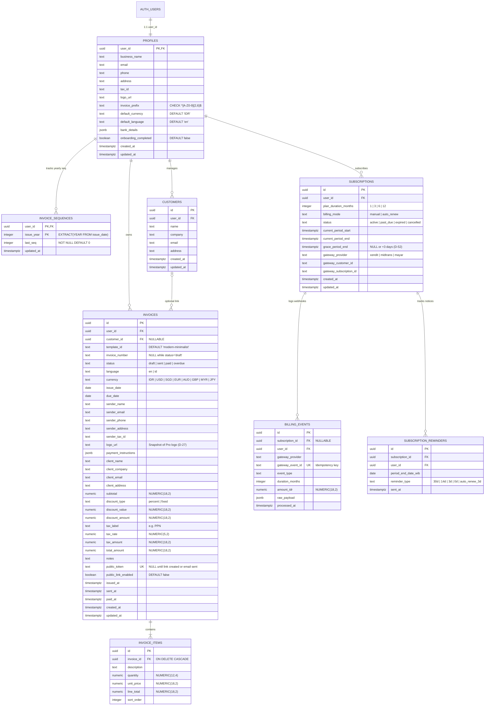

# DATABASE — PostgreSQL Schema, Atomic RPCs, RLS & Storage Policies

| Field | Value |
| :--- | :--- |
| Product name | **Tagiva** (`tagiva.com`, see `PRD.md` `D-59`) |
| Document status | **Approved** |
| Version | 1.1.0 |
| Last updated | 2026-10-27 |
| Depends on | `PRD.md` (v1.0.0), `DESIGN_SYSTEM.md` (v1.1.0), `UX_FLOWS.md` (v1.1.0), `ARCHITECTURE.md` (v1.1.0) |

---

## 0. Purpose of this document

This document defines the **complete Supabase PostgreSQL schema**, **constraints**, **indexes**, **transactional RPC functions**, **Row Level Security (RLS) policies**, and **Supabase Storage bucket policies**.

Its goals are:
1. Enforce data integrity and business rules (`D-01`–`D-56`) directly in PostgreSQL so invalid states (duplicate invoice numbers, floating-point drift, deleting a `Sent` invoice on Free, or editing an invoice while Lapsed) are impossible even if a client bypasses the UI (`NFR-2`, `NFR-4`, `NFR-6`).
2. Provide ready-to-run SQL DDL definitions that map 1:1 to `supabase/migrations/`.

How to read requirement keywords:
- **MUST**: required for MVP launch.
- **SHOULD**: expected for MVP. Can only be dropped with an explicit decision.

---

## 1. Reused decisions from prior documents

| Decision ID | Summary | Database Enforcement |
| :--- | :--- | :--- |
| **D-03** | 1 MVP template, extensible to future templates. | `invoices.template_id TEXT NOT NULL DEFAULT 'modern-minimalist'`. |
| **D-04, D-27** | Custom logo is Pro-only; stays on existing invoices after Pro ends. | `profiles.logo_url` + snapshot `invoices.logo_url` preserved on existing invoice rows. |
| **D-12, D-21, D-29, D-33** | Free/Lapsed capped at **3 saved invoices in total**; deleting gives back a slot; Free can delete **only `Draft`**. | Hard `DELETE` restores count (`COUNT(*) < 3`); RLS `DELETE` policy checks `status = 'draft'` for Free users. |
| **D-13, D-18, D-30, D-39, D-54, D-55, D-56** | `INV-[PREFIX]-[YYYY]-[MM]-[XXXX]`; `PREFIX` is `^[A-Z0-9]{2,6}$`; sequence per `(user_id, issue_year)`; drafts have `invoice_number = NULL`; 100% system-generated. | `invoice_sequences(user_id, issue_year)` table + `issue_invoice()` atomic RPC; `CHECK` constraint on prefix and number format. |
| **D-15, D-23, D-28** | Statuses: `draft`, `sent`, `paid`, `overdue`. Lapsed users are read-only except marking `sent`/`overdue` → `paid`. | Trigger & RLS policy block `Lapsed` updates to any column other than `status = 'paid'` and `paid_at`. |
| **D-16, D-22, D-48, D-52** | Durations `1, 3, 6, 12` months; `manual` & `auto_renew`; 3-day `past_due` grace period on failed auto-renew. | `subscriptions` table with `plan_duration_months`, `billing_mode`, `current_period_end`, and `grace_period_end`. |
| **D-25, D-32, D-46** | Profile stores `default_language` (`en` \| `id`) and `default_currency` (`IDR` default); per-invoice `language` and `currency`. | `CHECK` constraints on `profiles` and `invoices`. |
| **D-26, D-53** | Reminders at `30d, 14d, 3d, 0d` (manual) and `3d` pre-charge (auto-renew). | `subscription_reminders` table with `UNIQUE(subscription_id, period_end_date, reminder_type)`. |
| **D-40** | Public links stay viewable (with platform footer) when sender is Lapsed. | Public read query joins sender's plan state (`get_user_plan_state`) to set `show_platform_footer`. |
| **NFR-4** | Exact money math without floating-point rounding errors. | All currency amounts use `NUMERIC(18, 2)`; quantities use `NUMERIC(12, 4)`. |

---

## 2. Entity-Relationship Diagram (ERD)



---

## 3. Complete SQL Schema Specification

### 3.1 `profiles` Table (`D-04`, `D-25`, `D-32`, `D-38`, `D-39`, `D-54`)

```sql
CREATE TABLE public.profiles (
  user_id UUID PRIMARY KEY REFERENCES auth.users(id) ON DELETE CASCADE,
  business_name TEXT NOT NULL DEFAULT '',
  email TEXT NOT NULL DEFAULT '',
  phone TEXT NOT NULL DEFAULT '',
  address TEXT NOT NULL DEFAULT '',
  tax_id TEXT NOT NULL DEFAULT '',
  logo_url TEXT,
  invoice_prefix TEXT NOT NULL DEFAULT 'USR'
    CONSTRAINT chk_profiles_invoice_prefix CHECK (invoice_prefix ~ '^[A-Z0-9]{2,6}$'),
  default_currency TEXT NOT NULL DEFAULT 'IDR'
    CONSTRAINT chk_profiles_default_currency CHECK (
      default_currency IN ('IDR', 'USD', 'SGD', 'EUR', 'AUD', 'GBP', 'MYR', 'JPY')
    ),
  default_language TEXT NOT NULL DEFAULT 'en'
    CONSTRAINT chk_profiles_default_language CHECK (default_language IN ('en', 'id')),
  bank_details JSONB NOT NULL DEFAULT '{"bank_name": "", "account_number": "", "account_holder": "", "notes": ""}'::jsonb,
  onboarding_completed BOOLEAN NOT NULL DEFAULT FALSE,
  created_at TIMESTAMPTZ NOT NULL DEFAULT NOW(),
  updated_at TIMESTAMPTZ NOT NULL DEFAULT NOW()
);
```

### 3.2 `invoice_sequences` Table (`D-13`, `D-18`, `D-56`)

Tracks the per-account, per-issue-year counter. Changing `profiles.invoice_prefix` does **not** reset this table (`D-18`), and a new row with `last_seq = 1` is automatically created when an invoice is issued in a new `issue_year` (`D-56`).

```sql
CREATE TABLE public.invoice_sequences (
  user_id UUID NOT NULL REFERENCES public.profiles(user_id) ON DELETE CASCADE,
  issue_year INTEGER NOT NULL CONSTRAINT chk_issue_year CHECK (issue_year BETWEEN 2000 AND 2100),
  last_seq INTEGER NOT NULL DEFAULT 0 CONSTRAINT chk_last_seq CHECK (last_seq >= 0),
  updated_at TIMESTAMPTZ NOT NULL DEFAULT NOW(),
  PRIMARY KEY (user_id, issue_year)
);
```

### 3.3 `customers` Table (`FR-5.11`)

```sql
CREATE TABLE public.customers (
  id UUID PRIMARY KEY DEFAULT gen_random_uuid(),
  user_id UUID NOT NULL REFERENCES public.profiles(user_id) ON DELETE CASCADE,
  name TEXT NOT NULL,
  company TEXT NOT NULL DEFAULT '',
  email TEXT NOT NULL DEFAULT '',
  address TEXT NOT NULL DEFAULT '',
  created_at TIMESTAMPTZ NOT NULL DEFAULT NOW(),
  updated_at TIMESTAMPTZ NOT NULL DEFAULT NOW()
);

CREATE INDEX idx_customers_user_id ON public.customers(user_id);
```

### 3.4 `invoices` & `invoice_items` Tables (`D-03`, `D-15`, `D-17`, `D-27`, `D-30`, `D-44`–`D-46`, `D-55`)

```sql
CREATE TABLE public.invoices (
  id UUID PRIMARY KEY DEFAULT gen_random_uuid(),
  user_id UUID NOT NULL REFERENCES public.profiles(user_id) ON DELETE CASCADE,
  customer_id UUID REFERENCES public.customers(id) ON DELETE SET NULL,
  template_id TEXT NOT NULL DEFAULT 'modern-minimalist',

  -- Numbering (D-30, D-55): NULL while status = 'draft', required once status != 'draft'
  invoice_number TEXT,
  status TEXT NOT NULL DEFAULT 'draft'
    CONSTRAINT chk_invoices_status CHECK (status IN ('draft', 'sent', 'paid', 'overdue')),

  -- Localization & Currency (D-17, D-46)
  language TEXT NOT NULL DEFAULT 'en'
    CONSTRAINT chk_invoices_language CHECK (language IN ('en', 'id')),
  currency TEXT NOT NULL DEFAULT 'IDR'
    CONSTRAINT chk_invoices_currency CHECK (
      currency IN ('IDR', 'USD', 'SGD', 'EUR', 'AUD', 'GBP', 'MYR', 'JPY')
    ),

  -- Dates
  issue_date DATE NOT NULL DEFAULT (CURRENT_TIMESTAMP AT TIME ZONE 'Asia/Jakarta')::date,
  due_date DATE NOT NULL,

  -- Sender Snapshot (ARCH-A04, D-27)
  sender_name TEXT NOT NULL DEFAULT '',
  sender_email TEXT NOT NULL DEFAULT '',
  sender_phone TEXT NOT NULL DEFAULT '',
  sender_address TEXT NOT NULL DEFAULT '',
  sender_tax_id TEXT NOT NULL DEFAULT '',
  logo_url TEXT,
  payment_instructions JSONB NOT NULL DEFAULT '{}'::jsonb,

  -- Recipient
  client_name TEXT NOT NULL DEFAULT '',
  client_company TEXT NOT NULL DEFAULT '',
  client_email TEXT NOT NULL DEFAULT '',
  client_address TEXT NOT NULL DEFAULT '',

  -- Financials (NFR-4, D-44, D-45)
  subtotal NUMERIC(18, 2) NOT NULL DEFAULT 0.00 CHECK (subtotal >= 0),
  discount_type TEXT NOT NULL DEFAULT 'percent'
    CONSTRAINT chk_invoices_discount_type CHECK (discount_type IN ('percent', 'fixed')),
  discount_value NUMERIC(18, 2) NOT NULL DEFAULT 0.00 CHECK (discount_value >= 0),
  discount_amount NUMERIC(18, 2) NOT NULL DEFAULT 0.00 CHECK (discount_amount >= 0),
  tax_label TEXT NOT NULL DEFAULT 'PPN',
  tax_rate NUMERIC(5, 2) NOT NULL DEFAULT 0.00 CHECK (tax_rate >= 0 AND tax_rate <= 100),
  tax_amount NUMERIC(18, 2) NOT NULL DEFAULT 0.00 CHECK (tax_amount >= 0),
  total_amount NUMERIC(18, 2) NOT NULL DEFAULT 0.00 CHECK (total_amount >= 0),

  notes TEXT NOT NULL DEFAULT '',

  -- Public Link (FR-8)
  public_token TEXT UNIQUE,
  public_link_enabled BOOLEAN NOT NULL DEFAULT FALSE,

  -- Lifecycle Timestamps
  issued_at TIMESTAMPTZ,
  sent_at TIMESTAMPTZ,
  paid_at TIMESTAMPTZ,
  created_at TIMESTAMPTZ NOT NULL DEFAULT NOW(),
  updated_at TIMESTAMPTZ NOT NULL DEFAULT NOW(),

  -- Invariant: Drafts MUST NOT have an invoice_number; non-drafts MUST have a valid invoice_number (D-30, D-55)
  CONSTRAINT chk_draft_number_invariant CHECK (
    (status = 'draft' AND invoice_number IS NULL)
    OR
    (status <> 'draft' AND invoice_number ~ '^INV-[A-Z0-9]{2,6}-[0-9]{4}-(0[1-9]|1[0-2])-[0-9]{4,}$')
  )
);

-- Uniqueness: Two invoices in the same account can never share an invoice_number (FR-2.7)
CREATE UNIQUE INDEX idx_invoices_unique_number_per_user
  ON public.invoices(user_id, invoice_number)
  WHERE invoice_number IS NOT NULL;

CREATE INDEX idx_invoices_user_status ON public.invoices(user_id, status, created_at DESC);
CREATE INDEX idx_invoices_public_token ON public.invoices(public_token) WHERE public_token IS NOT NULL;

CREATE TABLE public.invoice_items (
  id UUID PRIMARY KEY DEFAULT gen_random_uuid(),
  invoice_id UUID NOT NULL REFERENCES public.invoices(id) ON DELETE CASCADE,
  description TEXT NOT NULL DEFAULT '',
  quantity NUMERIC(12, 4) NOT NULL DEFAULT 1 CHECK (quantity >= 0),
  unit_price NUMERIC(18, 2) NOT NULL DEFAULT 0.00 CHECK (unit_price >= 0),
  line_total NUMERIC(18, 2) NOT NULL DEFAULT 0.00 CHECK (line_total >= 0),
  sort_order INTEGER NOT NULL DEFAULT 0
);

CREATE INDEX idx_invoice_items_invoice_id ON public.invoice_items(invoice_id, sort_order);
```

### 3.5 `subscriptions`, `billing_events` & `subscription_reminders` Tables (`D-16`, `D-22`, `D-26`, `D-48`, `D-52`, `D-53`)

```sql
CREATE TABLE public.subscriptions (
  id UUID PRIMARY KEY DEFAULT gen_random_uuid(),
  user_id UUID NOT NULL REFERENCES public.profiles(user_id) ON DELETE CASCADE,
  plan_duration_months INTEGER NOT NULL
    CONSTRAINT chk_plan_duration CHECK (plan_duration_months IN (1, 3, 6, 12)),
  billing_mode TEXT NOT NULL DEFAULT 'manual'
    CONSTRAINT chk_billing_mode CHECK (billing_mode IN ('manual', 'auto_renew')),
  status TEXT NOT NULL DEFAULT 'active'
    CONSTRAINT chk_subscription_status CHECK (status IN ('active', 'past_due', 'expired', 'cancelled')),
  current_period_start TIMESTAMPTZ NOT NULL,
  current_period_end TIMESTAMPTZ NOT NULL,
  grace_period_end TIMESTAMPTZ, -- Populated (+3 days) when auto_renew charge fails (D-52)
  gateway_provider TEXT NOT NULL
    CONSTRAINT chk_gateway_provider CHECK (gateway_provider IN ('xendit', 'midtrans', 'mayar')),
  gateway_customer_id TEXT,
  gateway_subscription_id TEXT,
  created_at TIMESTAMPTZ NOT NULL DEFAULT NOW(),
  updated_at TIMESTAMPTZ NOT NULL DEFAULT NOW()
);

CREATE INDEX idx_subscriptions_user_status ON public.subscriptions(user_id, status, current_period_end DESC);

CREATE TABLE public.billing_events (
  id UUID PRIMARY KEY DEFAULT gen_random_uuid(),
  subscription_id UUID REFERENCES public.subscriptions(id) ON DELETE SET NULL,
  user_id UUID NOT NULL REFERENCES public.profiles(user_id) ON DELETE CASCADE,
  gateway_provider TEXT NOT NULL,
  gateway_event_id TEXT NOT NULL UNIQUE, -- Guarantees webhook idempotency
  event_type TEXT NOT NULL,
  duration_months INTEGER,
  amount_idr NUMERIC(18, 2),
  raw_payload JSONB NOT NULL,
  processed_at TIMESTAMPTZ NOT NULL DEFAULT NOW()
);

CREATE TABLE public.subscription_reminders (
  id UUID PRIMARY KEY DEFAULT gen_random_uuid(),
  subscription_id UUID NOT NULL REFERENCES public.subscriptions(id) ON DELETE CASCADE,
  user_id UUID NOT NULL REFERENCES public.profiles(user_id) ON DELETE CASCADE,
  period_end_date_wib DATE NOT NULL,
  reminder_type TEXT NOT NULL
    CONSTRAINT chk_reminder_type CHECK (reminder_type IN ('30d', '14d', '3d', '0d', 'auto_renew_3d')),
  sent_at TIMESTAMPTZ NOT NULL DEFAULT NOW(),
  UNIQUE (subscription_id, period_end_date_wib, reminder_type)
);

CREATE TABLE public.invoice_email_logs (
  id UUID PRIMARY KEY DEFAULT gen_random_uuid(),
  user_id UUID NOT NULL REFERENCES public.profiles(user_id) ON DELETE CASCADE,
  invoice_id UUID NOT NULL REFERENCES public.invoices(id) ON DELETE CASCADE,
  recipient_email TEXT NOT NULL,
  sent_date_wib DATE NOT NULL DEFAULT (CURRENT_TIMESTAMP AT TIME ZONE 'Asia/Jakarta')::date,
  resend_message_id TEXT,
  sent_at TIMESTAMPTZ NOT NULL DEFAULT NOW()
);

CREATE INDEX idx_email_logs_user_date ON public.invoice_email_logs(user_id, sent_date_wib);
CREATE INDEX idx_email_logs_invoice_date ON public.invoice_email_logs(invoice_id, sent_date_wib);
```

---

## 4. Database Functions (RPCs) & Triggers

### 4.1 `get_user_plan_state(p_user_id UUID)`
Evaluates whether a user is `'pro'`, `'lapsed'`, or `'free'`, honoring the 3-day `past_due` grace period (`D-52`).

```sql
CREATE OR REPLACE FUNCTION public.get_user_plan_state(p_user_id UUID)
RETURNS TEXT
LANGUAGE plpgsql
STABLE
SECURITY DEFINER
SET search_path = public
AS $$
DECLARE
  v_has_active BOOLEAN;
  v_has_any BOOLEAN;
BEGIN
  -- Active Pro: current_period_end is in the future, OR status is past_due within the 3-day grace window (D-52)
  SELECT EXISTS (
    SELECT 1 FROM public.subscriptions
    WHERE user_id = p_user_id
      AND (
        (status IN ('active', 'cancelled') AND current_period_end > NOW())
        OR (status = 'past_due' AND grace_period_end IS NOT NULL AND grace_period_end > NOW())
      )
  ) INTO v_has_active;

  IF v_has_active THEN
    RETURN 'pro';
  END IF;

  SELECT EXISTS (
    SELECT 1 FROM public.subscriptions WHERE user_id = p_user_id
  ) INTO v_has_any;

  IF v_has_any THEN
    RETURN 'lapsed';
  END IF;

  RETURN 'free';
END;
$$;
```

### 4.2 Atomic `issue_invoice(p_invoice_id UUID)` RPC (`D-13`, `D-18`, `D-30`, `D-55`, `D-56`)
Atomically transitions a `Draft` invoice to `Sent` and generates its `INV-[PREFIX]-[YYYY]-[MM]-[XXXX]` number keyed by `(user_id, EXTRACT(YEAR FROM issue_date))`.

```sql
CREATE OR REPLACE FUNCTION public.issue_invoice(p_invoice_id UUID)
RETURNS TEXT
LANGUAGE plpgsql
SECURITY DEFINER
SET search_path = public
AS $$
DECLARE
  v_invoice public.invoices%ROWTYPE;
  v_prefix TEXT;
  v_year INTEGER;
  v_month TEXT;
  v_next_seq INTEGER;
  v_seq_str TEXT;
  v_new_number TEXT;
BEGIN
  -- Lock the invoice row
  SELECT * INTO v_invoice
  FROM public.invoices
  WHERE id = p_invoice_id AND user_id = auth.uid()
  FOR UPDATE;

  IF NOT FOUND THEN
    RAISE EXCEPTION 'Invoice not found or access denied';
  END IF;

  -- If already issued, return existing number idempotently
  IF v_invoice.status <> 'draft' AND v_invoice.invoice_number IS NOT NULL THEN
    RETURN v_invoice.invoice_number;
  END IF;

  -- Read user's current prefix (D-18, D-54)
  SELECT invoice_prefix INTO v_prefix
  FROM public.profiles
  WHERE user_id = v_invoice.user_id;

  -- Extract YYYY and MM from issue_date (D-56)
  v_year := EXTRACT(YEAR FROM v_invoice.issue_date)::INTEGER;
  v_month := TO_CHAR(v_invoice.issue_date, 'MM');

  -- Atomically increment the yearly counter for (user_id, issue_year)
  INSERT INTO public.invoice_sequences (user_id, issue_year, last_seq, updated_at)
  VALUES (v_invoice.user_id, v_year, 1, NOW())
  ON CONFLICT (user_id, issue_year)
  DO UPDATE SET
    last_seq = public.invoice_sequences.last_seq + 1,
    updated_at = NOW()
  RETURNING last_seq INTO v_next_seq;

  -- Zero-pad to 4 digits, or expand to 5+ digits if > 9999 (A-05)
  IF v_next_seq <= 9999 THEN
    v_seq_str := LPAD(v_next_seq::TEXT, 4, '0');
  ELSE
    v_seq_str := v_next_seq::TEXT;
  END IF;

  v_new_number := FORMAT('INV-%s-%s-%s-%s', v_prefix, v_year, v_month, v_seq_str);

  -- Update the invoice record
  UPDATE public.invoices
  SET
    invoice_number = v_new_number,
    status = 'sent',
    issued_at = NOW(),
    updated_at = NOW()
  WHERE id = p_invoice_id;

  RETURN v_new_number;
END;
$$;
```

---

## 5. Row Level Security (RLS) & Storage Policies (`NFR-2`, `NFR-6`)

RLS **MUST** be enabled on all tables (`ALTER TABLE ... ENABLE ROW LEVEL SECURITY`).

| Table | Operation | RLS Policy Rule |
| :--- | :--- | :--- |
| **`profiles`** | `SELECT`, `UPDATE` | `auth.uid() = user_id` (Note: updating `logo_url` to a non-null value requires `get_user_plan_state(auth.uid()) = 'pro'`, `D-04`). |
| **`customers`** | `ALL` | `auth.uid() = user_id`. |
| **`invoices`** | `SELECT` | `auth.uid() = user_id`. |
| **`invoices`** | `INSERT` | `auth.uid() = user_id` **AND** (`get_user_plan_state(auth.uid()) = 'pro'` **OR** `(SELECT COUNT(*) FROM public.invoices WHERE user_id = auth.uid()) < 3`) (`D-12`, `D-33`). |
| **`invoices`** | `UPDATE` | `auth.uid() = user_id` **AND**:<br/>• For `free` or `pro`: allowed (trigger prevents changing `invoice_number` once assigned or reverting to `draft`, `A-16`, `D-55`).<br/>• For `lapsed`: only allowed when transitioning `status` from `'sent'` / `'overdue'` to `'paid'` (`D-28`). |
| **`invoices`** | `DELETE` | `auth.uid() = user_id` **AND** (`get_user_plan_state(auth.uid()) = 'pro'` **OR** (`get_user_plan_state(auth.uid()) = 'free'` AND `status = 'draft'`)) (`D-29`; Lapsed cannot delete `D-28`). |
| **`invoice_items`** | `ALL` | Parent invoice belongs to `auth.uid()`, and parent invoice is editable (`get_user_plan_state(auth.uid()) IN ('free', 'pro')`). |
| **`subscriptions`** | `SELECT` | `auth.uid() = user_id` (Mutations are performed exclusively by the service-role webhook handler). |

### Supabase Storage Bucket: `business-logos` (`FR-6`)
- **Bucket Visibility:** Public read (so logos render on `/i/[token]` and inside PDFs), restricted write.
- **Upload / Update Policy (`INSERT`, `UPDATE`):**
  - Authenticated user where path starts with `{auth.uid()}/`
  - `get_user_plan_state(auth.uid()) = 'pro'` (`D-04`)
  - File size `<= 2097152` bytes (2 MB) and `mime_type IN ('image/png', 'image/jpeg', 'image/webp')` (`A-06`).

---

## 6. Assumptions in this document

| ID | Assumption |
| :--- | :--- |
| **DB-A01** | When a new user signs in with Google for the first time, an `AFTER INSERT ON auth.users` database trigger automatically creates their `public.profiles` row with a 3-letter uppercase alphanumeric prefix derived from their Google full name (falling back to `'USR'`). |
| **DB-A02** | Deleting an invoice on the Free (`Draft`) or Pro plan performs a hard `DELETE` on `public.invoices` (cascading to `public.invoice_items`), immediately reducing `COUNT(*)` so the Free slot is restored (`D-21`) while `public.invoice_sequences` remains untouched so issued numbers are never reused (`A-13`). |
| **DB-A03** | Public invoice page lookups (`/i/[token]`) execute via a single `SECURITY DEFINER` RPC `get_public_invoice_by_token(p_token TEXT)` that returns the invoice, its items, and `show_platform_footer` (`get_user_plan_state(user_id) <> 'pro'`, `D-40`) only when `public_link_enabled = TRUE` and `public_token = p_token`. |

---

## 7. Open questions in this document

All database-blocking questions (`Q-07`, `Q-11`, `Q-33`) have been resolved as `D-54`, `D-55`, and `D-56`. No unresolved database questions remain.

---

## 8. Change history

| Version | Date | Change |
| :--- | :--- | :--- |
| 1.0.0 | 2026-10-27 | Initial database specification aligned with `PRD.md` (`D-01`–`D-56`), `DESIGN_SYSTEM.md`, `UX_FLOWS.md`, and `ARCHITECTURE.md`. |
