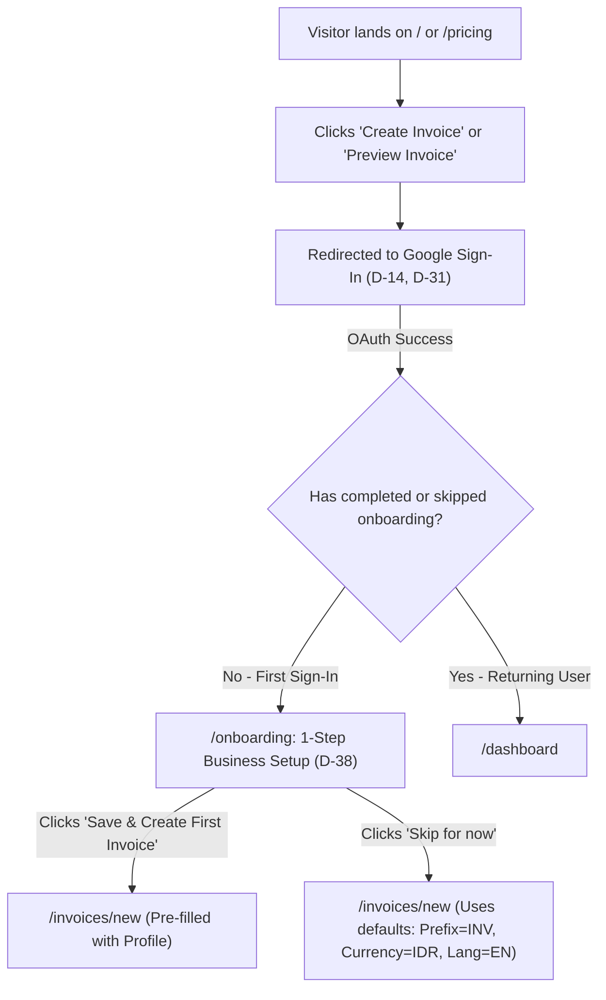
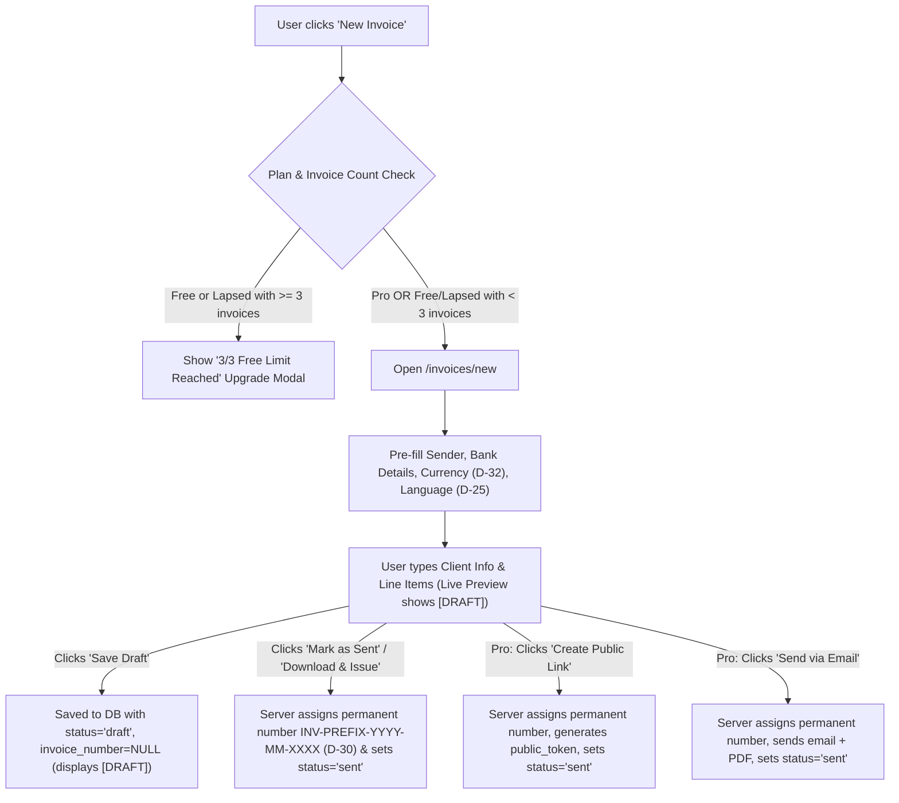
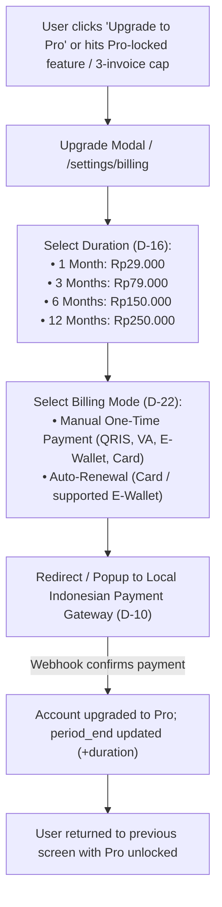

# UX_FLOWS — User Journeys, Screen States & Interaction Rules

| Field | Value |
| :--- | :--- |
| Product name | **Tagiva** (`tagiva.com`, see `PRD.md` `D-59`) |
| Document status | **Approved** |
| Version | 1.1.0 |
| Last updated | 2026-10-27 |
| Depends on | `PRD.md` (v1.0.0), `DESIGN_SYSTEM.md` (v1.1.0) |

---

## 0. Purpose of this document

This document defines **every user journey**, **screen inventory**, **state transition**, **empty/error state**, and **plan-limit interaction** across the application.

Its goals are:
1. Ensure every business rule in `PRD.md` (`D-01`–`D-43`) has an unambiguous user-facing flow and UI state.
2. Prevent dead ends (for example: what happens when a Visitor clicks "Preview", when a Free user hits 3/3 invoices, or when a Pro user becomes Lapsed).
3. Serve as the blueprint for route structure (`ARCHITECTURE.md`), API endpoints (`API.md`), and end-to-end test cases (`TESTING.md`).

How to read requirement keywords:
- **MUST**: required for MVP launch.
- **SHOULD**: expected for MVP. Can only be dropped with an explicit decision.
- **MAY**: optional enhancement.

---

## 1. Reused decisions from `PRD.md` & `DESIGN_SYSTEM.md`

| Decision ID | Summary | UX Flow Impact |
| :--- | :--- | :--- |
| **D-11, D-12** | Free plan capped at **3 saved invoices in total**; Logo, clean PDF, Public Link, and Email Send are **Pro-only**. | Free users see a `X / 3 Free slots` indicator; Pro actions trigger the Upgrade modal when clicked by Free/Lapsed users. |
| **D-13, D-18, D-30, D-39, D-42** | Number format `INV-[PREFIX]-[YYYY]-[MM]-[XXXX]`; annual reset; prefix editable on Free & Pro; drafts display `[DRAFT]` until issued. | Drafts never consume a sequence number; leaving `Draft` assigns the permanent number. |
| **D-14, D-24, D-31** | **Google sign-in only**; Visitors cannot create or preview an invoice before signing in. | Any "Create Invoice" or "Preview Invoice" CTA triggers Google OAuth before opening the builder/preview. |
| **D-15, D-21, D-29** | Statuses: `Draft`, `Sent`, `Paid`, `Overdue`. Deleting gives back a Free slot, but Free users can delete **only `Draft`**. | Delete button is active on `Draft` for Free users and disabled with tooltip on `Sent`, `Overdue`, and `Paid`. |
| **D-16, D-22** | Pro plans: **1m (Rp29k), 3m (Rp79k), 6m (Rp150k), 12m (Rp250k)**; supports **manual** and **auto-renew** billing. | Checkout modal lets the user pick duration and (where supported by payment method) toggle auto-renewal. |
| **D-17, D-25, D-32** | Default invoice language (default EN) and default currency (default IDR) stored in profile; overridable per invoice. | Header/Settings includes a quick default-language button; Builder pre-fills both and allows per-invoice override. |
| **D-23, D-26, D-27, D-28, D-33, D-40** | Expiry reminders at **30d, 14d, 3d, 0d**. When Pro ends (Lapsed): existing invoices are read-only except marking `Sent`/`Overdue` → `Paid`; logo stays on old invoices; existing public links stay viewable with platform footer; can create new invoices only if total < 3. | Dedicated Lapsed read-only mode, reminder banners, and public link fallback rules. |
| **D-38** | First-time Google sign-in shows a **1-step Business Setup screen** with "Skip for now". | Smooth post-signup onboarding before entering the dashboard/builder. |

---

## 2. Screen & Route Inventory

| Route Path | Access | Screen Name | Primary Purpose |
| :--- | :--- | :--- | :--- |
| `/` | Public | **Landing Page** | Value proposition, static sample invoice showcase, pricing summary, and "Sign in with Google to Create Invoice" CTA (`D-24`, `D-31`). |
| `/pricing` | Public | **Pricing Page** | Detailed breakdown of Free vs. Pro (`1m / 3m / 6m / 12m`, `D-16`) and FAQ. |
| `/login` | Public (unauthenticated) | **Sign-In Screen** | Single "Continue with Google" button (`D-14`) + link to Terms & Privacy Policy (`NFR-3`). |
| `/onboarding` | Authenticated (first sign-in) | **1-Step Business Setup** | Quick setup of Business Name, Invoice Prefix (`D-39`), Default Currency (`D-32`), Default Invoice Language (`D-25`), and Bank Details (`D-38`). |
| `/dashboard` | Authenticated (`Free`, `Pro`, `Lapsed`) | **Invoices Dashboard** | Invoice list, status filter tabs, Free slot counter (`X / 3`), expiry banner (`D-26`), and "New Invoice" CTA. |
| `/invoices/new` | Authenticated (`Free < 3`, `Pro`, `Lapsed < 3`) | **Invoice Builder (New)** | Split-view form & live A4 preview (`FR-1.1`). Redirects to `/dashboard?upgrade=limit` if Free/Lapsed user is at `≥ 3` invoices (`FR-5.4`). |
| `/invoices/[id]` | Authenticated (Owner) | **Invoice Builder / Detail View** | Editable for `Free` & `Pro`; read-only with "Mark as Paid" enabled for `Lapsed` (`D-28`). |
| `/clients` | Authenticated | **Clients Directory** | Manage saved client records (`FR-5.11`). |
| `/settings` | Authenticated | **Business & Account Settings** | Business details, Prefix (`D-39`), Default Currency (`D-32`), Default Invoice Language (`D-25`), Bank Details, and Logo upload (`Pro` only, `D-04`). |
| `/settings/billing` | Authenticated | **Subscription & Billing** | Current plan status, expiry date, auto-renew toggle (`D-22`), plan duration selector (`D-16`), and payment history. |
| `/i/[token]` | Public (unguessable token) | **Client Public Invoice Page** | Read-only client view of a shared invoice (`FR-8`), with "Download PDF" and 1-click "Copy Bank Account" buttons (`D-40`, `D-43`). |

---

## 3. Core User Flows

### 3.1 Flow 1: Visitor → Google Sign-In → 1-Step Onboarding (`D-14`, `D-24`, `D-31`, `D-38`)

#### Step-by-Step Requirements:
1. **Visitor Gate (`D-24`, `D-31`):**
   - Visitors **MUST NOT** be able to open the live invoice preview or generate a PDF without signing in.
   - If the landing page displays teaser input fields (such as Client Name or Amount), clicking "Preview Invoice" saves those fields in `sessionStorage` (`A-22`), triggers Google Sign-In, and restores them once the user reaches `/invoices/new`.
2. **1-Step Business Setup (`/onboarding` — `D-38`):**
   - Fields presented on a single clean card:
     - **Business / Your Name** (pre-filled from Google profile name, editable)
     - **Invoice Prefix** (`D-13`, `D-39`): pre-filled with 3 uppercase letters derived from the user's name (for example `TAT`), with live preview: `Example: INV-TAT-2026-10-0001`.
     - **Default Currency** (`D-32`): defaults to `IDR (Rp)`.
     - **Default Invoice Language** (`D-25`): defaults to `English` (with toggle button for `Bahasa Indonesia`).
     - **Bank Details for Payment Instructions** (`FR-1.10`): Bank Name, Account Number, Account Holder Name.
   - **Actions:**
     - Primary button: **"Save & Create First Invoice"** → saves profile and navigates to `/invoices/new`.
     - Secondary button: **"Skip for now"** → saves default profile (`default_currency = IDR`, `default_language = en`, auto-generated 3-letter prefix) and navigates to `/invoices/new`.

---

### 3.2 Flow 2: Creating, Saving & Issuing an Invoice (`FR-1`, `FR-2`, `D-30`)

#### Explicit Rules for Draft vs. Issued Invoices:
1. **Slot Consumption (`D-12`):**
   - Saving a new `Draft` creates an invoice record in the database and counts as **1 used slot** toward the 3-invoice Free cap.
   - Deleting that `Draft` deletes the record and **immediately restores the slot** (`D-21`, `D-29`).
2. **Draft Numbering (`D-30`, `D-42`):**
   - While an invoice is in `Draft` status, its database `invoice_number` is `NULL`, and the UI, live preview, and draft PDF display `[DRAFT]`.
   - Deleting a `Draft` **never leaves a gap** in the numbering sequence because no sequence number was assigned yet.
3. **Issuing / Leaving Draft (`FR-2.3`):**
   - An invoice leaves `Draft` and receives its permanent `INV-[PREFIX]-[YYYY]-[MM]-[XXXX]` number when the user performs any of these actions:
     1. Clicks **"Issue / Mark as Sent"** (available on Free & Pro).
     2. Clicks **"Create Public Link"** (Pro only, `FR-8.1`).
     3. Clicks **"Send via Email"** (Pro only, `FR-9.6`).
   - Before a Free user marks a `Draft` as `Sent`, a confirmation popover warns:
     *"Issuing this invoice will assign its permanent invoice number (`INV-ACM-2026-10-0001`). Note: On the Free plan, Sent invoices cannot be deleted."* (`D-29`).
4. **Downloading a PDF:**
   - **Download Draft PDF:** Downloads the PDF with `[DRAFT]` in the number field and stays in `Draft` status.
   - **Issue & Download PDF:** Assigns the permanent number, transitions status to `Sent`, and downloads the numbered PDF.

---

### 3.3 Flow 3: Invoice Status Lifecycle & Deletion Matrix (`D-15`, `D-21`, `D-28`, `D-29`)

```mermaid
stateDiagram-v2
    [*] --> Draft : Created (Number = [DRAFT])
    Draft --> Sent : Issued / Email Sent / Public Link Created\n(Permanent INV-PREFIX-YYYY-MM-XXXX assigned)
    Draft --> [*] : Deleted (Free & Pro)\nRestores 1 Free slot, no sequence gap
    Sent --> Paid : User clicks 'Mark as Paid'\n(Free, Pro, and Lapsed)
    Sent --> Overdue : Current Date > Due Date (WIB)\nand status != Paid
    Overdue --> Paid : User clicks 'Mark as Paid'\n(Free, Pro, and Lapsed)
    Paid --> Sent : User clicks 'Undo Paid' (Free & Pro only;\nreverts to Sent or Overdue based on Due Date)
```

#### Action Permission Matrix by User Role & Invoice Status:

| Action on Invoice | `Free` on `Draft` | `Free` on `Sent` / `Overdue` / `Paid` | `Pro` (Any Status) | `Lapsed` on Existing Invoices |
| :--- | :---: | :---: | :---: | :---: |
| **Edit fields / line items** | ✅ | ✅ (`A-04`, number locked) | ✅ (number locked once assigned) | ❌ Disabled (`D-23`, `D-28`) |
| **Issue (`Draft` → `Sent`)** | ✅ | — | ✅ | ✅ only on new draft if total < 3 (`D-33`) |
| **Mark `Sent` / `Overdue` → `Paid`** | — | ✅ | ✅ | ✅ **Enabled** (`D-28`, `A-18`) |
| **Revert `Paid` → `Sent`** | — | ✅ | ✅ | ❌ Disabled (`D-28`) |
| **Revert to `Draft`** | — | ❌ Never (`A-16`) | ❌ Never (`A-16`) | ❌ Never |
| **Delete Invoice** | ✅ Restores slot (`D-21`) | ❌ Blocked (`D-29`) | ✅ Allowed (`A-12`) | ❌ Blocked (`D-28`) |
| **Download PDF** | ✅ With footer | ✅ With footer | ✅ Clean (no footer) | ✅ With footer (`D-28`) |
| **Public Link / Send Email** | 🔒 Opens Pro Modal | 🔒 Opens Pro Modal | ✅ | 🔒 Opens Pro Modal |

---

### 3.4 Flow 4: Multi-Channel Delivery (Pro: Public Link & Email — `FR-8`, `FR-9`)

#### A. Public Shareable Link Flow (`FR-8`, `D-40`, `D-43`)
1. Pro user clicks **"Share Link"** on an invoice.
2. If the invoice was a `Draft`, it is automatically issued (assigned `INV-[PREFIX]-[YYYY]-[MM]-[XXXX]`, status → `Sent`).
3. A modal displays the public URL (`https://tagiva.com/i/[public_token]`) with:
   - **"Copy Link"** button (shows toast *"Link copied to clipboard"*).
   - **"Open in new tab"** link.
   - **"Revoke / Disable Link"** toggle (`FR-8.4`).
4. **Client Experience on `/i/[token]`:**
   - Top utility bar: Invoice status badge (`Unpaid`, `Paid`, or `Overdue`, `D-43`), **"Download PDF"** button, and **"Copy Bank Account Number"** button.
   - Center: The A4 invoice sheet rendered in `Inter` (`D-41`) in the invoice's selected language (`D-17`).
   - Bottom: Clean (no platform footer) if the sender is currently `Pro`; shows the platform footer if the sender has become `Lapsed` (`D-40`).

#### B. Send via Email Flow (`FR-9`)
1. Pro user clicks **"Send Email"** on an invoice.
2. Modal opens with pre-filled fields:
   - **To:** Client's email from the invoice (editable).
   - **Subject:** Pre-filled in the invoice's language:
     - EN: `Invoice [Number] from [Business Name]`
     - ID: `Faktur [Number] dari [Business Name]`
   - **Message:** Editable short note (pre-filled with a polite default in EN or ID).
   - **Attachment indicator:** `📎 [Invoice_Number].pdf (Attached automatically)` + Public Link button included in email body.
3. User clicks **"Send Invoice"**:
   - If `Draft`, assigns the permanent invoice number first.
   - Sends email via Resend with `Reply-To` set to the user's business email (`A-08`).
   - Sets invoice status to `Sent` and records `sent_at`.

---

### 3.5 Flow 5: Upgrading to Pro & Managing Billing (`D-10`, `D-16`, `D-22`)

#### Extending / Renewing Before Expiry (`A-14`):
- When an active Pro user pays manually before their current `current_period_end`, the purchased duration (`1m / 3m / 6m / 12m`) is **added onto `current_period_end`** so they never lose remaining days.

---

### 3.6 Flow 6: Expiry Reminders & Transition to Lapsed (`D-23`, `D-26`, `D-27`, `D-28`, `D-33`, `D-40`)

1. **Reminder Schedule (`D-26`):**
   - Scheduled job checks active subscriptions daily at `08:00 WIB` (`NFR-5`).
   - Sends email + enables in-app banner when remaining days equal **30 days**, **14 days**, **3 days**, or **0 days (last day)** (`A-20`, `A-21`).
2. **When `current_period_end` Passes Without Renewal:**
   - User role becomes **Lapsed**.
   - **Dashboard view:** Shows all historical invoices and a banner explaining that Pro has ended.
   - **Opening an existing invoice:**
     - All fields are read-only (`D-23`).
     - The saved logo remains visible on that invoice (`D-27`).
     - If status is `Sent` or `Overdue`, the **"Mark as Paid"** button is active so the user can still close out unpaid invoices (`D-28`).
     - Downloading the PDF works and includes the platform footer (`D-28`).
   - **Creating a new invoice (`D-33`):**
     - If the Lapsed user has **fewer than 3** total saved invoices (`0`, `1`, or `2`), they can click "New Invoice" and create invoices up to the 3-invoice cap (using Free tier rules: no logo on the new invoice, footer included, `A-23`).
     - If the Lapsed user has **3 or more** saved invoices, clicking "New Invoice" opens the "Renew Pro to Create More Invoices" modal.

---

## 4. Empty, Loading & Error States

| Screen / Action | State | Required UX Behavior |
| :--- | :--- | :--- |
| **Dashboard (0 invoices)** | Empty State | Illustration/icon + *"You haven't created any invoices yet"* + primary **"Create Your First Invoice"** button. |
| **Clients Directory (0 clients)** | Empty State | *"No saved clients yet. Clients you bill can be saved here for 1-click reuse"* + **"Add Client"** button. |
| **Invoice Builder Auto-Save / Save** | Saving / Saved | Top bar shows `Unsaved changes` → `Saving...` → `Saved as Draft` with timestamp. |
| **PDF Generation** | Loading / Error | Button shows spinner (`Generating PDF...`, disabled during request). On failure, shows non-destructive toast with **"Retry"** action without losing form state. |
| **Public Invoice (`/i/[token]`)** | Invalid or Revoked Token | Clean 404/Revoked card: *"This invoice link is no longer active or does not exist. Please contact the sender directly."* (No internal stack traces or user data leaked, `NFR-2`). |

---

## 5. Assumptions in this document

| ID | Assumption |
| :--- | :--- |
| **UX-A01** | Every new user gets a sensible auto-generated 3-letter prefix (from their Google display name, falling back to `USR`) during onboarding so they can issue an invoice immediately even if they click "Skip for now". |
| **UX-A02** | Editing a client's details inside the Invoice Builder offers a checkbox `"Save/update this client in my Clients list"` so users don't have to visit `/clients` separately. |
| **UX-A03** | When a Free user issues a `Draft` (changing it to `Sent`), a confirmation dialog informs them that `Sent` invoices cannot be deleted on the Free plan (`D-29`). |
| **UX-A04** | In the Invoice Builder, switching the **Invoice Language** toggle (`EN` \| `ID`) immediately updates the live preview's labels without reloading or clearing any form inputs. |
| **UX-A05** | Changing the **Default Invoice Language** (`D-25`) or **Default Currency** (`D-32`) in Settings affects **new** invoices created from that moment on, and does not retroactively alter already-saved invoices. |

---

## 6. Open questions in this document

All UX flow questions (`UX-Q01`–`UX-Q04`) have been resolved and recorded as `D-44`, `D-45`, `D-46`, and `D-47` in `PRD.md`.

---

## 7. Change history

| Version | Date | Change |
| :--- | :--- | :--- |
| 1.0.0 | 2026-10-27 | Initial specification covering all user flows, status state machine, and role matrices aligned with `PRD.md` v1.0.0 and `DESIGN_SYSTEM.md` v1.1.0. |
| 1.1.0 | 2026-10-27 | Approved. Confirmed `D-44` (`PPN 11%` chip), `D-45` (`%` or Fixed discount toggle), `D-46` (currency list), and `D-47` (English default UI with `EN \| ID` switcher). |
